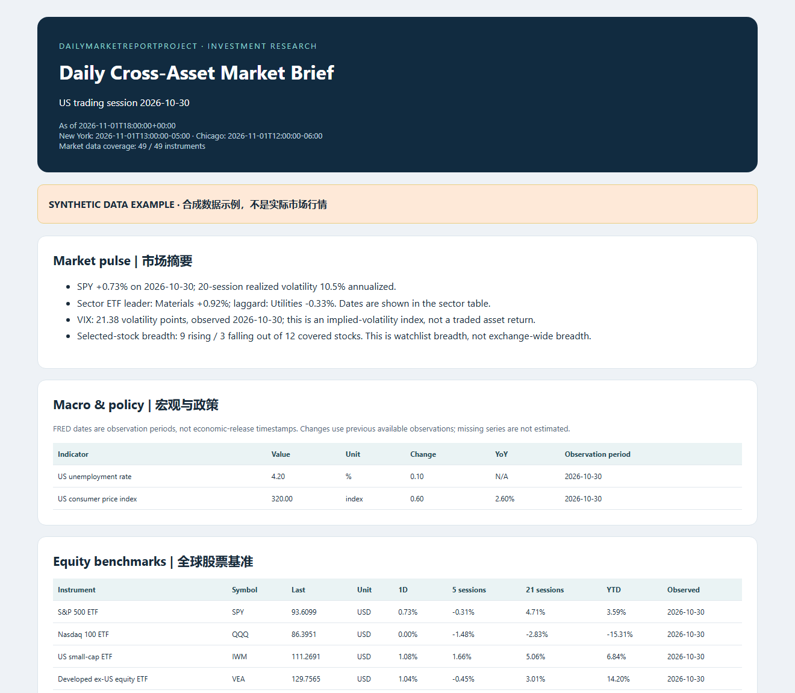

# DailyMarketReportProject

**A daily cross-asset research brief for investment analysts: equities, fixed income, currencies, commodities, alternatives, and market risk.**

The project gathers completed-session market data, calculates performance and risk measures, organizes observations by asset class, and generates a self-contained HTML report, Markdown brief, charts, and a machine-readable JSON package. Its classification follows common CFA-style asset categories; it is not affiliated with CFA Institute.



## Coverage

| Research area | Included coverage |
| :--- | :--- |
| Macro and policy | Inflation, unemployment, payroll employment, and policy-rate observations through FRED or CSV |
| Equities | US/global benchmark ETFs, 11 US sector ETFs, selected stocks grouped by sector, returns and watchlist breadth |
| Fixed income | Treasury maturity exposures, TIPS, investment-grade/high-yield credit and EM debt ETFs; Treasury curve, real yields, breakevens and OAS from FRED/CSV |
| Currencies | EUR/USD, USD/JPY, USD/CNY and the US Dollar Index, with explicit quote directions |
| Commodities | Gold, silver, copper, WTI crude and natural-gas continuous futures quotes |
| Listed alternatives | Listed real estate, business development companies and bitcoin-exposure ETF |
| Derivatives and risk | VIX, realized volatility, moving-average screens and aligned cross-asset correlations |
| Disclosed trading activity | Imported provider-reported block trades and size-screened large trades, with disclosure delays and corrections |
| Valuation and calendar | Imported trailing/forward multiples, dividend yields, earnings and macro events |

The default universe contains **49 instruments** and is editable in `market_report/universe.json`. Selected stocks are a watchlist, not a full-market stock screen. Private-market valuations, complete options chains, and a consolidated trade-condition feed are not bundled.

## Quick start

Python 3.11 or newer:

```sh
python -m venv .venv
# Windows: .venv\Scripts\activate
# macOS/Linux: source .venv/bin/activate
python -m pip install -e .
market-report --mode live --fred-live --output output/latest
```

Open `output/latest/report.html`. The HTML embeds its charts and works without an external dashboard service. Use browser print if a PDF copy is needed.

Explicit report cutoff:

```sh
market-report --mode live --as-of 2026-11-01T18:00:00Z --fred-live --strict --output output/dated
```

Strict mode requires a current completed-session SPY benchmark; other feed gaps remain visible in the report. The cutoff requires a timezone. NYSE holidays and early closes determine the last completed US session; unfinished equity bars are excluded. Non-US-session daily bars use a conservative completion rule, so every observation date is displayed.

## Add your data sources

```sh
market-report --mode live --fred-csv path/to/rates.csv --blocks-csv path/to/trades.csv --events-csv path/to/events.csv --fundamentals-csv path/to/valuations.csv
```

For an exported price history instead of the public chart endpoint:

```sh
market-report --mode csv --prices-csv path/to/prices.csv --fred-csv path/to/rates.csv
```

[Input schemas](docs/DATA_SOURCES.md) describe source IDs, timestamps, units, corrections, and required fields. Example input templates are in `examples/`; they contain clearly identified synthetic records.

## Daily automation

The included [GitHub Actions workflow](.github/workflows/daily-report.yml) runs at **00:30 UTC Tuesday-Saturday**, corresponding to the preceding US weekday evening (20:30 New York during daylight time; 19:30 in standard time). It skips NYSE non-session dates and uploads report files as a `daily-market-report` artifact with 14-day retention.

Open **Actions → Daily cross-asset market report → Run workflow** for an on-demand run. GitHub schedules are best-effort, not an exact-time service. Artifact download may require GitHub sign-in. No emails, external messages, trades, or repository pushes are sent by the workflow.

The default hosted workflow uses public market history and attempts FRED. Feed-specific CSV inputs require you to configure a lawful retrieval step or supply them at local runtime. Private feeds and API keys are not included.

## Report quality

- Adjusted history is used for return calculations when fully available; raw close levels remain separately displayed.
- 5/21-session changes, prior-year-end YTD, 20-session realized volatility, moving averages, and relative volume use declared formulas.
- Volume alerts compare against the prior 20 sessions, excluding the current observation.
- US-session lag, source URL, retrieval timestamp, return basis, missing sections, and provider failures are preserved in JSON.
- Yield changes are basis points; credit OAS and curve slopes are not mixed with bond ETF returns.
- A 10Y-2Y slope uses same-date paired observations.
- Trades are filtered by trade time and disclosure time; the latest known correction/cancellation wins.
- Missing block data means **not configured**, not zero market activity. Large daily volume does not establish a block trade, trade direction, or institutional flow.

## Outputs and examples

- `report.html` — standalone bilingual market brief.
- `report.md` — readable Markdown version.
- `report.json` — analytics, provenance, feed status and errors.
- `charts/` — sector, correlation and same-date Treasury-curve figures when supported.

A [fully labeled synthetic report example](docs/sample/report.html) exercises every section without redistributing provider history. Generate it yourself:

```sh
market-report --mode sample --as-of 2026-11-01T18:00:00Z --output output/sample
python -m unittest discover -s tests -v
```

[Validation results](docs/VALIDATION.md) record the executed live-source and calculation checks.

## Source and interpretation boundaries

The default price source is Yahoo Finance's unofficial chart interface; availability, rate limits, adjustment conventions and permissions can change. FRED access is optional and may be delayed or unavailable. Review provider terms for your use and redistribution. Raw provider datasets are not committed here.

FRED observation periods are not release timestamps, and downloaded series may be revised. Historical price history can also be restated. The report is a current research brief, not a point-in-time backtesting dataset. Futures quotes can be affected by contract rolls, and ETF returns are not direct returns on illiquid private assets.

The report provides sourced observations and research screens. It does not invent news, earnings dates, consensus estimates, causal explanations, holdings, or trade recommendations. No paid or complete US block-trade feed is implied.
