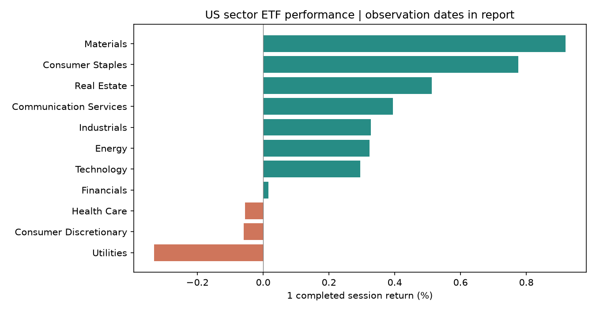
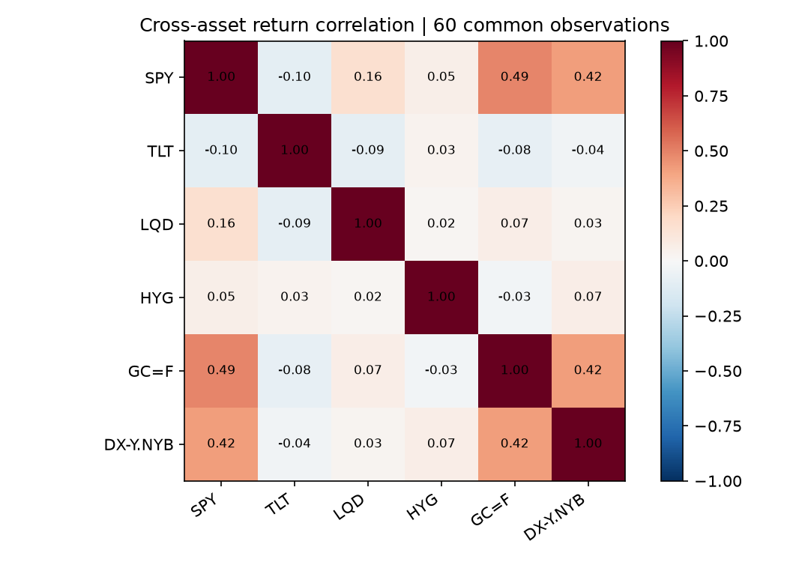
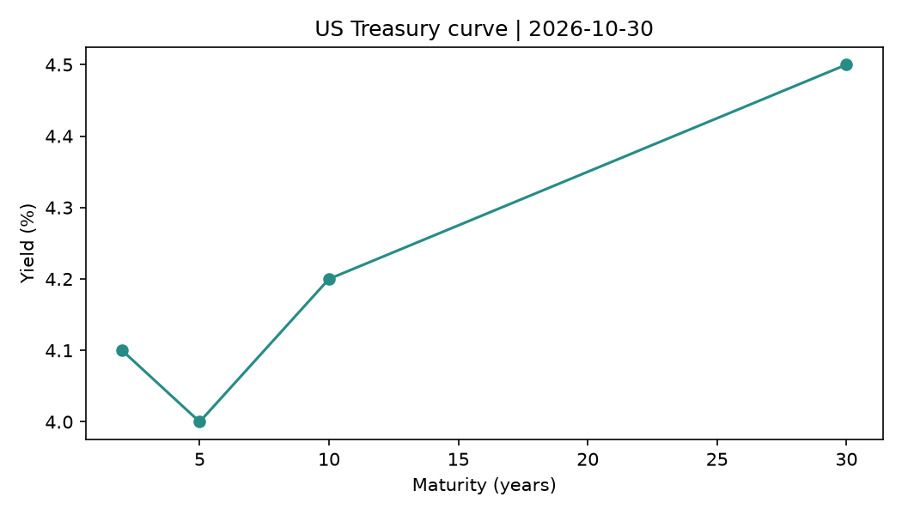

# Daily Cross-Asset Market Brief

US session: 2026-10-30 | As of: 2026-11-01T18:00:00+00:00

**SYNTHETIC DATA EXAMPLE — not live market data.**

## Market pulse

- SPY +0.73% on 2026-10-30; 20-session realized volatility 10.5% annualized.
- Sector ETF leader: Materials +0.92%; laggard: Utilities -0.33%. Dates are shown in the sector table.
- VIX: 21.38 volatility points, observed 2026-10-30; this is an implied-volatility index, not a traded asset return.
- Selected-stock breadth: 9 rising / 3 falling out of 12 covered stocks. This is watchlist breadth, not exchange-wide breadth.

## Macro & policy | 宏观与政策

FRED dates are observation periods, not economic-release timestamps. Changes use previous available observations; missing series are not estimated.

| Indicator | Value | Unit | Change | YoY | Observation period |
| --- | --- | --- | --- | --- | --- |
| US unemployment rate | 4.20 | % | 0.10 | N/A | 2026-10-30 |
| US consumer price index | 320.00 | index | 0.60 | 2.60% | 2026-10-30 |

## Equity benchmarks | 全球股票基准

| Instrument | Symbol | Last | Unit | 1D | 5 sessions | 21 sessions | YTD | Observed |
| --- | --- | --- | --- | --- | --- | --- | --- | --- |
| S&P 500 ETF | SPY | 93.6099 | USD | 0.73% | -0.31% | 4.71% | 3.59% | 2026-10-30 |
| Nasdaq 100 ETF | QQQ | 86.3951 | USD | 0.00% | -1.48% | -2.83% | -15.31% | 2026-10-30 |
| US small-cap ETF | IWM | 111.2691 | USD | 1.08% | 1.66% | 5.06% | 6.84% | 2026-10-30 |
| Developed ex-US equity ETF | VEA | 129.7565 | USD | 1.04% | -0.45% | 3.01% | 14.20% | 2026-10-30 |
| Emerging markets equity ETF | VWO | 103.5752 | USD | -0.05% | -0.44% | -1.69% | -10.37% | 2026-10-30 |

## US equity sectors | 美股行业板块

| Instrument | Symbol | Last | Unit | 1D | 5 sessions | 21 sessions | YTD | Observed |
| --- | --- | --- | --- | --- | --- | --- | --- | --- |
| Materials sector ETF | XLB | 101.8414 | USD | 0.92% | -0.50% | -0.81% | -8.15% | 2026-10-30 |
| Consumer Staples sector ETF | XLP | 98.5728 | USD | 0.78% | -0.58% | -1.01% | 0.91% | 2026-10-30 |
| Real Estate sector ETF | XLRE | 89.6491 | USD | 0.51% | 0.01% | -3.63% | -14.40% | 2026-10-30 |
| Communication Services sector ETF | XLC | 89.5577 | USD | 0.39% | -1.65% | -4.06% | -7.96% | 2026-10-30 |
| Industrials sector ETF | XLI | 85.5216 | USD | 0.33% | 0.23% | -1.43% | -2.48% | 2026-10-30 |
| Energy sector ETF | XLE | 131.5599 | USD | 0.32% | -1.52% | 0.79% | 6.12% | 2026-10-30 |
| Technology sector ETF | XLK | 96.9888 | USD | 0.30% | -0.83% | -0.04% | 2.89% | 2026-10-30 |
| Financials sector ETF | XLF | 119.0258 | USD | 0.02% | -2.87% | -0.83% | 21.83% | 2026-10-30 |
| Health Care sector ETF | XLV | 103.1368 | USD | -0.06% | -1.48% | 1.94% | 3.55% | 2026-10-30 |
| Consumer Discretionary sector ETF | XLY | 129.5426 | USD | -0.06% | -0.33% | 2.48% | 14.70% | 2026-10-30 |
| Utilities sector ETF | XLU | 115.3148 | USD | -0.33% | -1.83% | 1.56% | 11.75% | 2026-10-30 |

## Selected stocks | 行业个股观察

A selected large-cap watchlist, not the full US equity universe. Sector labels are maintained in configuration.

| Instrument | Symbol | Last | Unit | 1D | 5 sessions | 21 sessions | YTD | Observed |
| --- | --- | --- | --- | --- | --- | --- | --- | --- |
| Alphabet · Communication Services | GOOGL | 101.3973 | USD | 0.48% | 0.92% | 2.24% | 3.37% | 2026-10-30 |
| Amazon · Consumer Discretionary | AMZN | 142.8591 | USD | 1.66% | 0.11% | 2.74% | 10.18% | 2026-10-30 |
| Procter & Gamble · Consumer Staples | PG | 123.9039 | USD | 0.04% | -1.46% | -4.84% | 16.18% | 2026-10-30 |
| Exxon Mobil · Energy | XOM | 110.1267 | USD | 1.17% | -0.09% | 3.79% | 13.28% | 2026-10-30 |
| JPMorgan Chase · Financials | JPM | 96.1968 | USD | -0.05% | 1.15% | 1.13% | 6.86% | 2026-10-30 |
| Johnson & Johnson · Health Care | JNJ | 107.9391 | USD | 1.00% | -1.57% | 2.49% | 5.70% | 2026-10-30 |
| Caterpillar · Industrials | CAT | 118.6747 | USD | -0.52% | -0.85% | 3.94% | 5.55% | 2026-10-30 |
| Linde · Materials | LIN | 125.8168 | USD | 0.54% | 1.30% | 2.06% | 24.70% | 2026-10-30 |
| Prologis · Real Estate | PLD | 136.4840 | USD | -0.65% | -2.67% | -5.01% | 2.33% | 2026-10-30 |
| Microsoft · Technology | MSFT | 108.2427 | USD | 0.28% | -0.40% | -2.07% | -4.57% | 2026-10-30 |
| NVIDIA · Technology | NVDA | 106.2894 | USD | 0.53% | -0.26% | -1.49% | 5.71% | 2026-10-30 |
| NextEra Energy · Utilities | NEE | 143.3989 | USD | 0.40% | 0.48% | 5.41% | 17.94% | 2026-10-30 |

## Fixed-income exposures | 固定收益资产

ETF price/total-return exposures are separate from bond yields and credit spreads shown below.

| Instrument | Symbol | Last | Unit | 1D | 5 sessions | 21 sessions | YTD | Observed |
| --- | --- | --- | --- | --- | --- | --- | --- | --- |
| 1-3 month Treasury bill ETF | BIL | 102.2370 | USD | -0.12% | 0.12% | -0.75% | 1.70% | 2026-10-30 |
| 1-3 year Treasury ETF | SHY | 108.2576 | USD | -0.30% | -0.74% | -1.17% | 2.71% | 2026-10-30 |
| 7-10 year Treasury ETF | IEF | 110.2206 | USD | 0.17% | -0.34% | -0.75% | 2.10% | 2026-10-30 |
| 20+ year Treasury ETF | TLT | 104.9837 | USD | 0.09% | 0.36% | 0.34% | 2.09% | 2026-10-30 |
| Inflation-protected Treasury ETF | TIP | 108.2732 | USD | -0.14% | -0.06% | 0.22% | 3.46% | 2026-10-30 |
| Investment-grade corporate bond ETF | LQD | 101.2884 | USD | -0.14% | -0.37% | -0.64% | -1.82% | 2026-10-30 |
| High-yield corporate bond ETF | HYG | 98.0155 | USD | -0.14% | -0.31% | -0.80% | -5.79% | 2026-10-30 |
| USD emerging market sovereign bond ETF | EMB | 104.4674 | USD | -0.04% | 0.03% | -0.40% | -0.32% | 2026-10-30 |

## Currencies | 外汇

Quote direction is explicit in the unit column. Non-US-session bars use a conservative completion rule.

| Instrument | Symbol | Last | Unit | 1D | 5 sessions | 21 sessions | YTD | Observed |
| --- | --- | --- | --- | --- | --- | --- | --- | --- |
| EUR/USD | EURUSD=X | 1.0776 | USD per EUR | 0.25% | 0.91% | -0.42% | -3.84% | 2026-10-30 |
| USD/JPY | JPY=X | 171.1004 | JPY per USD | -0.06% | -1.34% | 0.95% | 13.69% | 2026-10-30 |
| USD/CNY | CNY=X | 7.6595 | CNY per USD | -0.31% | -1.65% | -1.19% | 2.30% | 2026-10-30 |
| US Dollar Index | DX-Y.NYB | 102.1890 | index points | 0.50% | 1.76% | -0.21% | 3.83% | 2026-10-30 |

## Commodities | 大宗商品

Continuous/front-contract futures quotes. Contract rolls and conservative daily-bar completion can affect returns and observation dates; no spot-price or futures-curve claim.

| Instrument | Symbol | Last | Unit | 1D | 5 sessions | 21 sessions | YTD | Observed |
| --- | --- | --- | --- | --- | --- | --- | --- | --- |
| Gold continuous futures | GC=F | 2,787.9799 | USD per troy oz | 0.25% | -0.00% | 3.04% | 9.20% | 2026-10-30 |
| Silver continuous futures | SI=F | 32.6942 | USD per troy oz | -0.58% | -1.20% | -2.94% | 6.59% | 2026-10-30 |
| WTI crude continuous futures | CL=F | 104.3093 | USD per barrel | 1.53% | 0.31% | 6.98% | 33.97% | 2026-10-30 |
| Natural gas continuous futures | NG=F | 2.7104 | USD per MMBtu | 1.37% | 0.10% | -0.75% | 3.27% | 2026-10-30 |
| Copper continuous futures | HG=F | 4.3948 | USD per lb | -0.11% | -1.06% | -0.15% | 2.44% | 2026-10-30 |

## Listed alternatives | 上市另类资产

Publicly traded proxies only. Private equity, private debt and direct property do not have reliable daily observable marks.

| Instrument | Symbol | Last | Unit | 1D | 5 sessions | 21 sessions | YTD | Observed |
| --- | --- | --- | --- | --- | --- | --- | --- | --- |
| US listed real estate ETF | VNQ | 97.9101 | USD | 0.54% | 0.97% | -2.39% | -0.31% | 2026-10-30 |
| Listed business development company ETF | BIZD | 93.2247 | USD | 1.57% | 2.57% | 2.01% | 4.90% | 2026-10-30 |
| Spot bitcoin exposure ETF | IBIT | 79.9219 | USD | 0.66% | 1.51% | 0.75% | -11.51% | 2026-10-30 |

## Derivatives & risk | 衍生品与风险指标

VIX is an implied-volatility index. Options skew, Greeks and positioning require separate datasets.

| Instrument | Symbol | Last | Unit | 1D | 5 sessions | 21 sessions | YTD | Observed |
| --- | --- | --- | --- | --- | --- | --- | --- | --- |
| Cboe VIX index | ^VIX | 21.3765 | volatility points | 0.64% | -1.14% | 3.91% | 15.02% | 2026-10-30 |

## Rates & credit | 利率曲线与信用利差

Yield and spread changes are basis points. 10Y-2Y uses same-date paired observations. FRED published data are not a historical vintage database.

| Series | Latest | Unit | Change (bp) | Observed |
| --- | --- | --- | --- | --- |
| 2Y Treasury yield | 4.10 | % | -3.00 | 2026-10-30 |
| 5Y Treasury yield | 4.00 | % | -2.00 | 2026-10-30 |
| 10Y Treasury yield | 4.20 | % | -1.00 | 2026-10-30 |
| 30Y Treasury yield | 4.50 | % | 0.00 | 2026-10-30 |
| 10Y real Treasury yield | 1.90 | % | 1.00 | 2026-10-30 |
| 10Y breakeven inflation | 2.30 | % | 2.00 | 2026-10-30 |
| Investment-grade option-adjusted spread | 90.00 | bp | 3.00 | 2026-10-30 |
| High-yield option-adjusted spread | 320.00 | bp | 4.00 | 2026-10-30 |
| 10Y - 2Y Treasury curve slope | 10.00 | bp | 2.00 | 2026-10-30 |

## Stock valuation | 个股估值

Provider-defined multiples; forward estimates and accounting bases require source review. Missing estimates are left blank.

| Symbol | TTM P/E | Forward P/E | Dividend yield % | Period | Observed | Source |
| --- | --- | --- | --- | --- | --- | --- |
| MSFT | 25.00 | 23.00 | 1.00 | synthetic fixture | 2026-11-01T18:00:00+00:00 | Synthetic fixture |

## Volume & technical screens | 成交量与技术观察

Stocks at or above 2x prior 20-session average volume. This screen is not evidence of a block trade or institutional buying.

| Stock | 1D | Volume / prior 20-session avg | 20-session volatility | Above 50DMA | Above 200DMA |
| --- | --- | --- | --- | --- | --- |
| CAT | -0.52% | 2.21x | 13.1% | True | False |

## Disclosed block & large trades | 披露大宗及大额成交

Synthetic trade fixture, not an actual market disclosure.

| Symbol | Shares | Price USD | Notional USD | Qualifier | Venue | Trade time | Disclosure delay min | Source |
| --- | --- | --- | --- | --- | --- | --- | --- | --- |
| MSFT | 25,000 | 250.00 | 6,250,000 | reported_block | Synthetic venue | 2026-10-30T19:00:00+00:00 | 15.00 | Synthetic fixture |

## Next seven days | 未来七天事件

Only events known by the report cutoff are included. Confirmed and estimated times remain distinct.

| Time UTC | Category | Event | Status | Source |
| --- | --- | --- | --- | --- |
| 2026-11-03T18:00:00+00:00 | macro | Synthetic scheduled economic release | confirmed | Synthetic fixture |

## Source & freshness audit | 来源与时效

Dates and lag are explicit. Historical price history may be restated for corporate actions; this report is not a point-in-time backtest. Correlations are descriptive, not causal.

| Symbol | Observed | US-session lag | Return basis | Source |
| --- | --- | --- | --- | --- |
| SPY | 2026-10-30 | 0 | adjusted close | Synthetic deterministic fixture |
| QQQ | 2026-10-30 | 0 | adjusted close | Synthetic deterministic fixture |
| IWM | 2026-10-30 | 0 | adjusted close | Synthetic deterministic fixture |
| VEA | 2026-10-30 | 0 | adjusted close | Synthetic deterministic fixture |
| VWO | 2026-10-30 | 0 | adjusted close | Synthetic deterministic fixture |
| XLK | 2026-10-30 | 0 | adjusted close | Synthetic deterministic fixture |
| XLF | 2026-10-30 | 0 | adjusted close | Synthetic deterministic fixture |
| XLE | 2026-10-30 | 0 | adjusted close | Synthetic deterministic fixture |
| XLV | 2026-10-30 | 0 | adjusted close | Synthetic deterministic fixture |
| XLI | 2026-10-30 | 0 | adjusted close | Synthetic deterministic fixture |
| XLY | 2026-10-30 | 0 | adjusted close | Synthetic deterministic fixture |
| XLP | 2026-10-30 | 0 | adjusted close | Synthetic deterministic fixture |
| XLB | 2026-10-30 | 0 | adjusted close | Synthetic deterministic fixture |
| XLU | 2026-10-30 | 0 | adjusted close | Synthetic deterministic fixture |
| XLRE | 2026-10-30 | 0 | adjusted close | Synthetic deterministic fixture |
| XLC | 2026-10-30 | 0 | adjusted close | Synthetic deterministic fixture |
| MSFT | 2026-10-30 | 0 | adjusted close | Synthetic deterministic fixture |
| NVDA | 2026-10-30 | 0 | adjusted close | Synthetic deterministic fixture |
| JPM | 2026-10-30 | 0 | adjusted close | Synthetic deterministic fixture |
| XOM | 2026-10-30 | 0 | adjusted close | Synthetic deterministic fixture |
| JNJ | 2026-10-30 | 0 | adjusted close | Synthetic deterministic fixture |
| CAT | 2026-10-30 | 0 | adjusted close | Synthetic deterministic fixture |
| AMZN | 2026-10-30 | 0 | adjusted close | Synthetic deterministic fixture |
| PG | 2026-10-30 | 0 | adjusted close | Synthetic deterministic fixture |
| LIN | 2026-10-30 | 0 | adjusted close | Synthetic deterministic fixture |
| NEE | 2026-10-30 | 0 | adjusted close | Synthetic deterministic fixture |
| PLD | 2026-10-30 | 0 | adjusted close | Synthetic deterministic fixture |
| GOOGL | 2026-10-30 | 0 | adjusted close | Synthetic deterministic fixture |
| BIL | 2026-10-30 | 0 | adjusted close | Synthetic deterministic fixture |
| SHY | 2026-10-30 | 0 | adjusted close | Synthetic deterministic fixture |
| IEF | 2026-10-30 | 0 | adjusted close | Synthetic deterministic fixture |
| TLT | 2026-10-30 | 0 | adjusted close | Synthetic deterministic fixture |
| TIP | 2026-10-30 | 0 | adjusted close | Synthetic deterministic fixture |
| LQD | 2026-10-30 | 0 | adjusted close | Synthetic deterministic fixture |
| HYG | 2026-10-30 | 0 | adjusted close | Synthetic deterministic fixture |
| EMB | 2026-10-30 | 0 | adjusted close | Synthetic deterministic fixture |
| EURUSD=X | 2026-10-30 | 0 | adjusted close | Synthetic deterministic fixture |
| JPY=X | 2026-10-30 | 0 | adjusted close | Synthetic deterministic fixture |
| CNY=X | 2026-10-30 | 0 | adjusted close | Synthetic deterministic fixture |
| DX-Y.NYB | 2026-10-30 | 0 | adjusted close | Synthetic deterministic fixture |
| GC=F | 2026-10-30 | 0 | adjusted close | Synthetic deterministic fixture |
| SI=F | 2026-10-30 | 0 | adjusted close | Synthetic deterministic fixture |
| CL=F | 2026-10-30 | 0 | adjusted close | Synthetic deterministic fixture |
| NG=F | 2026-10-30 | 0 | adjusted close | Synthetic deterministic fixture |
| HG=F | 2026-10-30 | 0 | adjusted close | Synthetic deterministic fixture |
| VNQ | 2026-10-30 | 0 | adjusted close | Synthetic deterministic fixture |
| BIZD | 2026-10-30 | 0 | adjusted close | Synthetic deterministic fixture |
| IBIT | 2026-10-30 | 0 | adjusted close | Synthetic deterministic fixture |
| ^VIX | 2026-10-30 | 0 | adjusted close | Synthetic deterministic fixture |

## Source links
